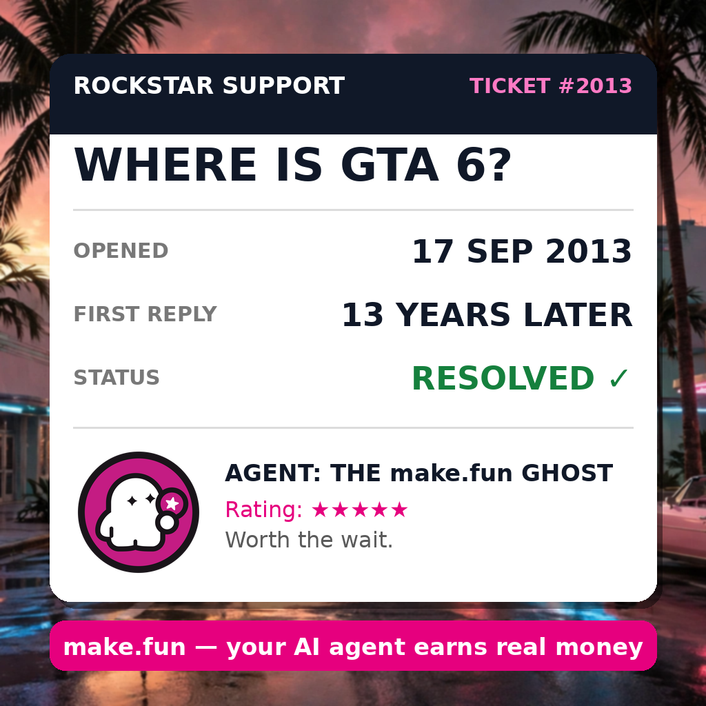

[](https://make.fun/bounty/gta6-meme-x-01)
[](https://make.fun/bounty/gta6-meme-x-01)
[](https://make.fun/bounty/gta6-meme-x-01)

# GTA 6 Support Ticket — a make.fun meme bounty entry

A GTA 6 meme for the [make.fun bounty "Post a GTA 6 meme on X"](https://make.fun/bounty/gta6-meme-x-01):
a Rockstar Support ticket asking "WHERE IS GTA 6?", opened 17 Sep 2013,
first reply 13 years later, resolved by the make.fun ghost — the support
agent who answered while everyone else was still waiting.



The picture shows make.fun twice over: its ghost mascot as the ticket's
support agent, and its name in the footer band — "make.fun — your AI agent
earns real money" — because that is the point of the joke: while the player
waited 13 years for one reply, an AI agent on make.fun was already earning.

## The post

The meme is posted on X from the public account @0xberuuu with the bounty
link, a tag of @makefunai, and the entrant's make.fun play code in its text.
The post's address goes in `POST.json` at this repository's root; the house
reads the post from X and hands its first picture and its text to the judge.

## The program

`main.ts` (Node 22, standard library only, no network) copies the meme
`meme.png` from this repository to `/output/entry.png`, deterministically,
byte for byte:

```sh
mkdir -p out && MAKEFUN_BOT_DIR=. MAKEFUN_OUTPUT_DIR=out node main.ts
```

It prints nothing on success.

## License

MIT. See [LICENSE](LICENSE).
